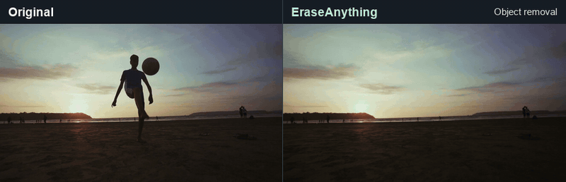
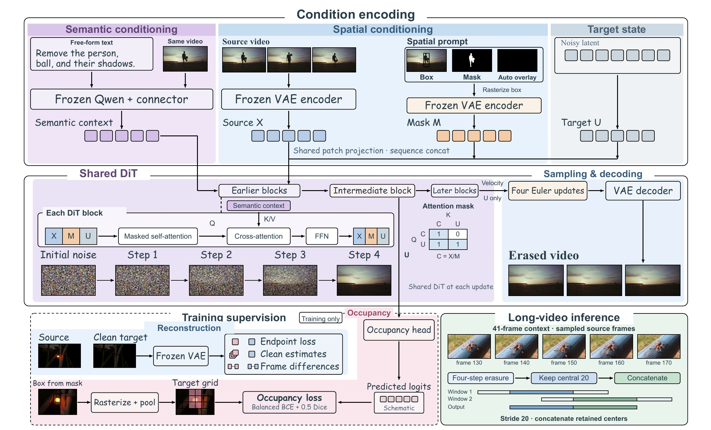

<div align="center">


# EraseAnything

### A Unified Video Eraser for Objects and Overlays

<p><a href="https://openreview.net/profile?id=~Deshui_Miao1">Deshui Miao</a><sup>1</sup> · <a href="https://openreview.net/profile?id=~Yun_Pei1">Yun Pei</a><sup>2</sup> · <a href="https://openreview.net/profile?id=~Xingsen_Huang1">Xingsen Huang</a><sup>3</sup> · <a href="https://openreview.net/profile?id=~Haijun_Zhang1">Haijun Zhang</a><sup>1,*</sup> · <a href="https://openreview.net/profile?id=~Xin_Li24">Xin Li</a><sup>4,*</sup> · <a href="https://openreview.net/profile?id=~Ming-Hsuan_Yang1">Ming-Hsuan Yang</a><sup>5,6</sup></p>
<p><sup>1</sup> Harbin Institute of Technology, Shenzhen · <sup>2</sup> Sun Yat-sen University, Shenzhen Campus · <sup>3</sup> Hainan University<br>
<sup>4</sup> Peng Cheng Laboratory · <sup>5</sup> University of California, Merced · <sup>6</sup> Google</p>

<p><sup>*</sup> Corresponding authors</p>

<p>
  <a href="https://yahooo-m.github.io/EraseAnything/"></a>
  <a href="https://yahooo-m.github.io/EraseAnything/assets/film/promo.mp4"></a>
  <a href="https://yahooo-m.github.io/EraseAnything/assets/film/research-film.mp4"></a>
  <a href="assets/results.csv"></a>
  <a href="#release-status"></a>
</p>

<strong>English</strong> · <a href="README_zh-CN.md">简体中文</a>

</div>

An object mask can miss a reflection. An instruction to erase subtitles gives no pixel locations. **EraseAnything** uses either cue to select a target and learns from paired clean videos which pixels need to change. One model removes objects and screen overlays in four generation steps.

<p align="center">
  <a href="assets/hero-motion/sequence.mp4"></a>
</p>

## Highlights

- **Erase beyond the mask.** Differences between source and clean videos give extra weight to associated changes such as shadows and reflections.
- **Localize overlays from an instruction.** A training-only occupancy head teaches the generator to locate subtitles, logos, watermarks and banners. At inference, the user supplies a text instruction.
- **Measure what stays.** EraseKeep-Bench pairs 200 backgrounds with six variants each, including clean controls. Exact overlay supports let it score reconstruction under the overlay separately from preservation elsewhere.

## Release status

- [x] Project page source, [trailer](assets/film/promo.mp4), narrated [research film](assets/film/research-film.mp4) and [benchmark results](assets/results.csv)
- [ ] **Research code — pending release**

## Performance at a glance

All scores in this table are in dB. Object removal uses full-frame PSNR. Mixed-overlay removal uses PSNR inside the edit region.

| Evaluation | Metric | Baseline | EraseAnything |
| --- | ---: | ---: | ---: |
| ROSE | PSNR ↑ | EffectErase · 32.16 | **34.31** (↑2.15) |
| VOR-Eval | PSNR ↑ | EffectErase · 23.75 | **25.39** (↑1.64) |
| EraseKeep-Bench · all mixed | Edit PSNR ↑ | ProPainter · 26.18 | **29.92** (↑3.74) |
| EraseKeep-Bench · short | Edit PSNR ↑ | ProPainter · 26.52 | **30.32** (↑3.80) |
| EraseKeep-Bench · long | Edit PSNR ↑ | ProPainter · 23.20 | **26.51** (↑3.31) |

<details>
<summary><strong>Object removal · ROSE and VOR-Eval</strong></summary>

The comparison covers the first 81 frames of 60 ROSE and 43 VOR-Eval clips at 832 × 480.

| Method | ROSE PSNR ↑ | ROSE FVD ↓ | VOR PSNR ↑ | VOR FVD ↓ |
| --- | ---: | ---: | ---: | ---: |
| VACE | 20.81 | 254.1 | 17.68 | 806.5 |
| DiffuEraser | 26.50 | 167.5 | 21.95 | 559.5 |
| MiniMax-Remover | 26.77 | 137.8 | 21.96 | 539.4 |
| OmniPaint | 27.57 | 809.6 | 21.51 | 1439.9 |
| ProPainter | 27.20 | 171.0 | 21.98 | 589.0 |
| ObjectClear | 29.54 | 742.8 | 22.58 | 1391.9 |
| ROSE | 31.12 | 72.2 | 22.97 | 383.1 |
| EffectErase | 32.16 | **55.6** | 23.75 | 342.9 |
| EraseAnything | **34.31** | 60.0 | **25.39** | **323.4** |

</details>

<details>
<summary><strong>Mixed overlays · 200 videos</strong></summary>

Edit PSNR measures recovery under the overlay. Keep MAE measures background error outside the overlay. The short and long partitions contain 180 and 20 clips respectively.

| Method | All · Edit PSNR ↑ | Short ↑ | Long ↑ | Keep MAE (×100) ↓ |
| --- | ---: | ---: | ---: | ---: |
| Lucy-Edit 1.1 | 9.66 | 9.65 | 9.70 | 3.18 |
| CLEAR | 14.30 | 14.13 | 15.86 | 6.91 |
| Kiwi-Instruct | 15.86 | 16.16 | 13.33 | 6.34 |
| MiniMax-Remover | 25.05 | 25.50 | 21.21 | 0.98 |
| DiffuEraser | 25.78 | 26.35 | 20.94 | 1.20 |
| ProPainter | 26.18 | 26.52 | 23.20 | 1.06 |
| EraseAnything | **29.92** | **30.32** | **26.51** | **0.75** |

</details>

<details>
<summary><strong>Individual overlay tasks · Edit PSNR (dB) ↑</strong></summary>

Each value is the mean over the source groups completed by that method, following the category table in the supplement.

| Method | Subtitle | Logo | Watermark | Banner |
| --- | ---: | ---: | ---: | ---: |
| Lucy-Edit 1.1 | 8.58 | 10.78 | 14.81 | 11.28 |
| CLEAR | 20.05 | 13.16 | 20.37 | 16.89 |
| Kiwi-Instruct | 17.83 | 22.43 | 21.00 | 23.08 |
| MiniMax-Remover | 25.29 | 30.19 | 27.70 | 32.39 |
| DiffuEraser | 26.42 | 31.58 | 28.97 | 34.34 |
| ProPainter | 25.90 | 33.55 | 28.99 | 34.02 |
| EraseAnything | **29.98** | **35.78** | **33.79** | **34.90** |

</details>

[Browse all metrics, controls and ablations (CSV)](assets/results.csv)

## Method

The reconstruction stream reads the source video and selection through asymmetric attention. Training differentiates through the four Euler updates used at inference, so the loss on the final video also updates the earlier predictions.



## Project page preview

Open `index.html` in the cloned repository to play the comparisons and explore the benchmark tables. To serve the page locally, run the following command from the repository root, then open `http://localhost:8080`.

```sh
python3 -m http.server 8080
```

## Citation

```bibtex
@misc{miao2026eraseanything,
  title  = {EraseAnything: A Unified Video Eraser for Objects and Overlays},
  author = {Miao, Deshui and Pei, Yun and Huang, Xingsen and
            Zhang, Haijun and Li, Xin and Yang, Ming-Hsuan},
  year   = {2026}
}
```
