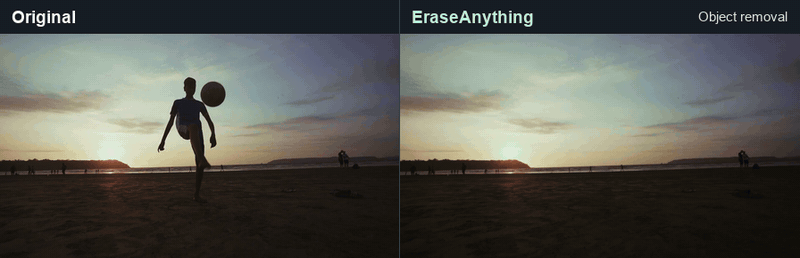
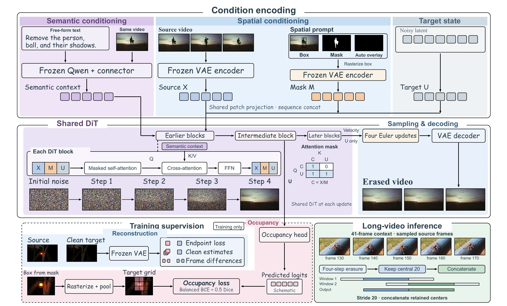

<div align="center">


# EraseAnything

### A Unified Video Eraser for Objects and Overlays

<p><a href="https://openreview.net/profile?id=~Deshui_Miao1">Deshui Miao</a><sup>1</sup> · <a href="https://openreview.net/profile?id=~Yun_Pei1">Yun Pei</a><sup>2</sup> · <a href="https://openreview.net/profile?id=~Xingsen_Huang1">Xingsen Huang</a><sup>3</sup> · <a href="https://openreview.net/profile?id=~Haijun_Zhang1">Haijun Zhang</a><sup>1,*</sup> · <a href="https://openreview.net/profile?id=~Xin_Li24">Xin Li</a><sup>4,5,*</sup> · <a href="https://openreview.net/profile?id=~Ming-Hsuan_Yang1">Ming-Hsuan Yang</a><sup>6</sup></p>
<p><sup>1</sup> 哈尔滨工业大学（深圳） · <sup>2</sup> 中山大学深圳校区 · <sup>3</sup> 海南大学<br>
<sup>4</sup> 鹏城实验室 · <sup>5</sup> Pazhou Lab · <sup>6</sup> 加州大学默塞德分校</p>

<p><sup>*</sup> 通讯作者</p>

<p>
  <a href="https://yahooo-m.github.io/EraseAnything/"></a>
  <a href="https://yahooo-m.github.io/EraseAnything/assets/film/promo.mp4"></a>
  <a href="https://yahooo-m.github.io/EraseAnything/assets/film/research-film.mp4"></a>
  <a href="assets/results.csv"></a>
  <a href="#发布进度"></a>
</p>

<a href="README.md">English</a> · <strong>简体中文</strong>

</div>

物体掩码可能漏掉镜中的倒影，一句“去掉字幕”也没有指出字幕的位置。**EraseAnything** 用掩码或指令选择目标，再从配对的干净视频中学习哪些像素需要改变。同一组模型权重通过四步生成完成物体与画面叠加元素的擦除。

<p align="center">
  <a href="assets/hero-motion/sequence.mp4"></a>
</p>

## 方法亮点

- **擦除掩码外的关联效果。** 利用原视频与干净视频的差异，模型在训练时对阴影、倒影等连带变化给予更高权重。
- **根据指令定位覆盖层。** 训练阶段的占据预测头让生成器学会定位字幕、台标、水印和横幅。推理时用户只需提供文字指令。
- **单独评估背景保持。** EraseKeep-Bench 为 200 段背景视频各构建六种变体，包含干净对照。利用精确的合成覆盖区域，分别衡量遮挡处的重建质量和其余区域的保真度。

## 发布进度

- [x] 项目页源码、[宣传片](assets/film/promo.mp4)、[英文解说研究影片](assets/film/research-film.mp4)和[评测结果](assets/results.csv)
- [ ] **研究代码待发布**

## 主要结果

下表单位均为 dB。物体移除评估整帧 PSNR，混合覆盖层擦除评估编辑区域内的 PSNR。

| 评测 | 指标 | 基线方法 | EraseAnything |
| --- | ---: | ---: | ---: |
| ROSE | PSNR ↑ | EffectErase · 32.16 | **34.31** (↑2.15) |
| VOR-Eval | PSNR ↑ | EffectErase · 23.75 | **25.39** (↑1.64) |
| EraseKeep-Bench · 全部混合覆盖层 | Edit PSNR ↑ | ProPainter · 26.18 | **29.92** (↑3.74) |
| EraseKeep-Bench · 短视频 | Edit PSNR ↑ | ProPainter · 26.52 | **30.32** (↑3.80) |
| EraseKeep-Bench · 长视频 | Edit PSNR ↑ | ProPainter · 23.20 | **26.51** (↑3.31) |

<details>
<summary><strong>物体移除 · ROSE 与 VOR-Eval</strong></summary>

对比使用 ROSE 的 60 段和 VOR-Eval 的 43 段视频，各取前 81 帧，分辨率为 832 × 480。

| 方法 | ROSE PSNR ↑ | ROSE FVD ↓ | VOR PSNR ↑ | VOR FVD ↓ |
| --- | ---: | ---: | ---: | ---: |
| VACE | 20.81 | 254.1 | 17.68 | 806.5 |
| DiffuEraser | 26.50 | 167.5 | 21.95 | 559.5 |
| MiniMax-Remover | 26.77 | 137.8 | 21.96 | 539.4 |
| OmniPaint | 27.57 | 809.6 | 21.51 | 1439.9 |
| ProPainter | 27.20 | 171.0 | 21.98 | 589.0 |
| ObjectClear | 29.54 | 742.8 | 22.58 | 1391.9 |
| ROSE | 31.12 | 72.2 | 22.97 | 383.1 |
| EffectErase | 32.16 | **55.6** | 23.75 | 342.9 |
| EraseAnything | **34.31** | 60.0 | **25.39** | **323.4** |

</details>

<details>
<summary><strong>混合覆盖层 · 200 段视频</strong></summary>

Edit PSNR 衡量覆盖区域内的恢复质量，Keep MAE 衡量覆盖区域外的背景误差。短视频和长视频分组分别包含 180 和 20 段。

| 方法 | 全部 · Edit PSNR ↑ | 短视频 ↑ | 长视频 ↑ | Keep MAE (×100) ↓ |
| --- | ---: | ---: | ---: | ---: |
| Lucy-Edit 1.1 | 9.66 | 9.65 | 9.70 | 3.18 |
| CLEAR | 14.30 | 14.13 | 15.86 | 6.91 |
| Kiwi-Instruct | 15.86 | 16.16 | 13.33 | 6.34 |
| MiniMax-Remover | 25.05 | 25.50 | 21.21 | 0.98 |
| DiffuEraser | 25.78 | 26.35 | 20.94 | 1.20 |
| ProPainter | 26.18 | 26.52 | 23.20 | 1.06 |
| EraseAnything | **29.92** | **30.32** | **26.51** | **0.75** |

</details>

<details>
<summary><strong>单一覆盖层任务 · Edit PSNR（dB）↑</strong></summary>

沿用补充材料的分类评测，每个数值为该方法已完成的源视频组均值。

| 方法 | 字幕 | Logo | 水印 | 横幅 |
| --- | ---: | ---: | ---: | ---: |
| Lucy-Edit 1.1 | 8.58 | 10.78 | 14.81 | 11.28 |
| CLEAR | 20.05 | 13.16 | 20.37 | 16.89 |
| Kiwi-Instruct | 17.83 | 22.43 | 21.00 | 23.08 |
| MiniMax-Remover | 25.29 | 30.19 | 27.70 | 32.39 |
| DiffuEraser | 26.42 | 31.58 | 28.97 | 34.34 |
| ProPainter | 25.90 | 33.55 | 28.99 | 34.02 |
| EraseAnything | **29.98** | **35.78** | **33.79** | **34.90** |

</details>

[查看全部指标、对照与消融结果（CSV）](assets/results.csv)

## 方法

重建分支通过非对称注意力读取原视频和选择条件。训练沿推理时使用的四次欧拉更新反向传播，因此最终视频的重建误差也能监督前面几步的预测。



## 预览项目页

克隆仓库后，直接打开 `index.html` 即可播放对比视频、浏览交互式评测表。也可以在仓库根目录运行下列命令，然后打开 `http://localhost:8080`。

```sh
python3 -m http.server 8080
```

## 引用

```bibtex
@misc{miao2026eraseanything,
  title  = {EraseAnything: A Unified Video Eraser for Objects and Overlays},
  author = {Miao, Deshui and Pei, Yun and Huang, Xingsen and
            Zhang, Haijun and Li, Xin and Yang, Ming-Hsuan},
  year   = {2026}
}
```
